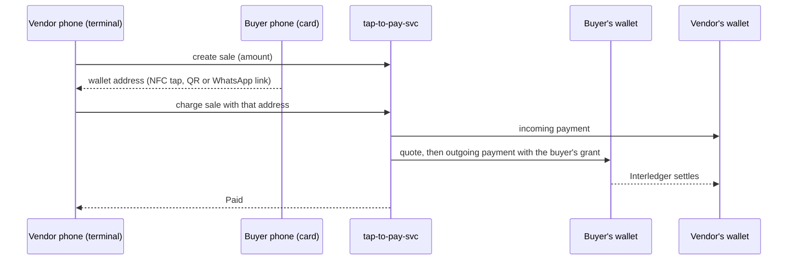

# Tap to Pay

**The vendor's Android phone is the terminal; the buyer's Android phone is the card.** One tap sends the buyer's Open Payments wallet address over NFC, and the money moves wallet to wallet on Interledger, within limits the buyer approved once. No card network, no terminal, no hardware.

Built by **Inteligencia Artesanal** at the Open Payments Hackathon, Ruta N, Medellín, October 16–17, 2026.

## The problem

Small vendors in Colombia still live on cash. A card terminal costs rent and fees, and paying from a phone usually means opening a bank app, scanning, typing the amount and confirming, every single time. Every sale paid in cash also leaves no record, so the vendor stays invisible to anyone who could lend to them.

## How a sale works

1. **Once:** the buyer approves a grant in their own wallet: "this terminal may charge me up to X per day". That is the only consent screen.
2. **Each sale:** the vendor types the amount. The buyer holds their phone to the vendor's phone, or scans the vendor's QR, or opens the link the vendor sent by WhatsApp.
3. The service checks the buyer's limits, then charges the buyer's wallet through Open Payments. The vendor sees *Paid*; the buyer sees the charge.
4. Over the cap, the buyer's own wallet refuses the payment: the limit is enforced by the wallet, not only by our code.



## What we use from Open Payments

| Feature | Where |
| --- | --- |
| Interactive outgoing-payment grant, asked **once**, with a daily `debitAmount` limit (`interval: R/<midnight>/P1D`) | `tap-to-pay-svc/scripts/grant-buyer.ts` |
| Incoming payment, quote and outgoing payment on every sale | `tap-to-pay-svc/src/open-payments/client.ts`, `src/services/sales.ts` |
| Token rotation when the grant's access token expires | `src/services/sales.ts` |
| Interaction hash verification on the grant redirect | `src/open-payments/hash.ts` |
| Sales between wallets in different currencies, checked against the quote's debit | `src/services/limits.ts`, `src/services/sales.ts` |

## Repository

| Folder | What it is |
| --- | --- |
| [`tap-to-pay-svc/`](tap-to-pay-svc/) | Express 5 + TypeScript service: the only place that talks to wallets. Prisma + PostgreSQL, Open Payments Node SDK, Vitest |
| [`tap-to-pay-app/`](tap-to-pay-app/) | Expo (React Native) Android app, one APK per role. A Kotlin module (`modules/nfc-tap`) emulates the card (HCE) and reads it (reader mode) |
| [`SDD.md`](SDD.md) | The full design: actors, architecture, data model, API, flows, security, decisions |
| [`AI_USAGE.md`](AI_USAGE.md), [`prompts/`](prompts/) | How we used AI, and every prompt |

## Run it

**Service** (Node 24, Docker):

```bash
cd tap-to-pay-svc
cp .env.example .env          # Test Wallet addresses, developer key id, private.key path
docker compose up -d          # PostgreSQL on localhost:55000
npm install && npm run db:migrate && npm run db:generate
npm run seed                  # one buyer and one vendor from .env
npm run grant:buyer -- --buyer <name>   # the buyer's one-time consent in the Test Wallet
npm run dev                   # http://0.0.0.0:4000
npm test                      # unit tests against fakes, no network
```

**App** (Android with NFC; the buyer's phone needs host card emulation):

```bash
cd tap-to-pay-app
cp .env.example .env          # EXPO_PUBLIC_API_URL=<the service URL>
npm install
scripts/build-apk.sh vendor release https://<service-url>
scripts/build-apk.sh buyer release https://<service-url>
```

A release APK needs the service on HTTPS. Details for development builds, two phones and logs are in [SDD.md section 14](SDD.md#14-developer-workflow).

## Status

- **Working:** sales by NFC tap, QR and WhatsApp link; consent once with a daily cap the wallet enforces; per-payment and daily caps the buyer edits in the app; several wallets per buyer and per vendor; cross-currency sales; vendor dashboard and transaction history; buyer history.
- **Shortcuts for the demo** (listed with their fixes in [SDD.md section 11](SDD.md#11-security-and-trust-boundaries)): the consent is given from a laptop script, not from the app; the API has no authentication; the grant token is stored in plain text.
- **Next:** consent inside the app, a challenge-response on the tap, and a verifiable sales statement the vendor can share with a cooperative or lender.

## Team

Inteligencia Artesanal: Jose Ríos (Jorius), Víctor Villadiego, Jacobo Zuluaga, Santiago Gómez, Manuel Gil.
