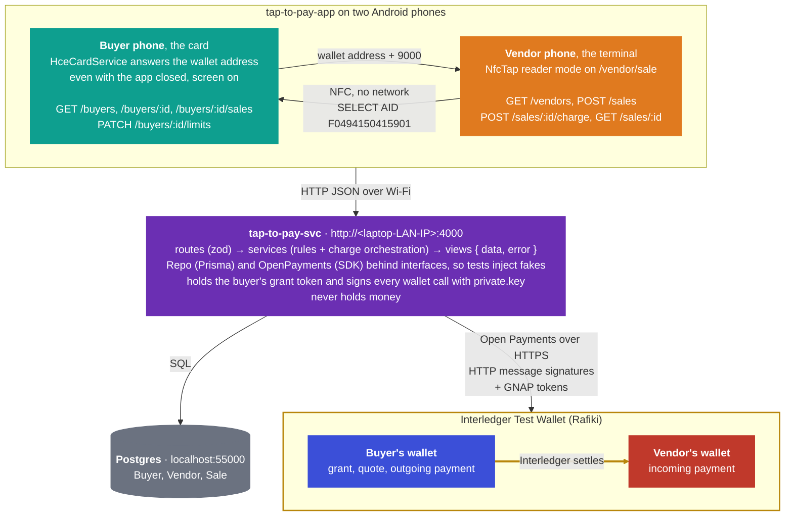
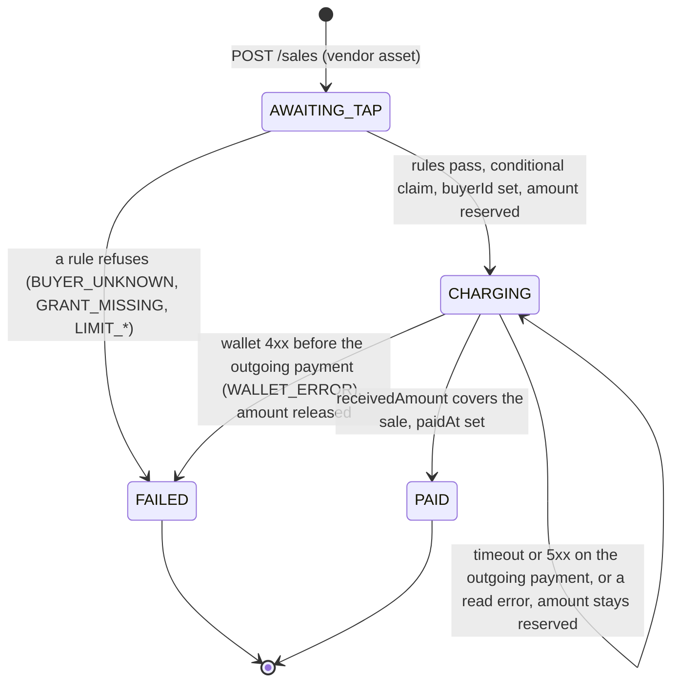

# Tap to Pay: Software Design Document

Inteligencia Artesanal · Open Payments Hackathon, Ruta N, Medellín, 16–17 October 2026 · as of 2026-10-16

The idea in one line: **the vendor's Android phone is the terminal, the buyer's Android phone is the card.** One tap moves the buyer's Open Payments wallet address over NFC. The service charges that wallet through Open Payments, within limits the buyer approved once, and the money moves wallet to wallet on the Interledger Test Wallet.

Contents

- [Tap to Pay: Software Design Document](#tap-to-pay-software-design-document)
  - [1. Purpose and scope](#1-purpose-and-scope)
  - [2. Problem, goals and non-goals](#2-problem-goals-and-non-goals)
  - [3. Actors and the three wallet addresses](#3-actors-and-the-three-wallet-addresses)
  - [4. Monorepo layout and architecture](#4-monorepo-layout-and-architecture)
  - [5. Tech stack](#5-tech-stack)
  - [6. Mobile app design](#6-mobile-app-design)
  - [7. Service design](#7-service-design)
  - [8. Data model](#8-data-model)
  - [9. API contract](#9-api-contract)
  - [10. Flows](#10-flows)
  - [11. Security and trust boundaries](#11-security-and-trust-boundaries)
  - [12. Configuration and environment](#12-configuration-and-environment)
  - [13. Testing strategy](#13-testing-strategy)
  - [14. Developer workflow](#14-developer-workflow)
  - [15. Decisions and known limitations](#15-decisions-and-known-limitations)
  - [16. Build order for the event](#16-build-order-for-the-event)
  - [17. AI usage declaration](#17-ai-usage-declaration)
  - [18. Prompt pack](#18-prompt-pack)

---

## 1. Purpose and scope

This document is the complete design of the tap-to-pay system: one repository holding two independent applications, `tap-to-pay-svc`, an Express with TypeScript service, and `tap-to-pay-app`, an Expo Android app. The practice code is excluded from the hackathon submission: the rules require every line of submission code to be written during the event, so this document carries the knowledge, not the code.

It covers the product idea, the parties and their wallet addresses, the monorepo layout, the exact tech stack, both applications, the data model, the HTTP contract, the per-sale flow with every failure, security boundaries, configuration, tests, the two-phone developer workflow, the decisions made and their costs, a build order with hours, the AI usage declaration, and the ordered prompts that drive the rebuild.

Out of scope: login and signup, KYC (done by the wallet provider), iOS (Apple restricts host card emulation), production hardening beyond what section 11 names.

## 2. Problem, goals and non-goals

Small vendors in Latin American markets cannot afford a card terminal, and buyers increasingly carry a phone, not cash. Open Payments gives every wallet a public address and a standard way for a third party to be authorized to move money from it. Tap to pay turns any two Android phones (with NFC capabilities) into a terminal and a card on top of that standard, with no card network and no hardware.

**Goals**

1. One tap, one real payment: the buyer phone touches the vendor phone, and money moves from the buyer's wallet to the vendor's wallet through Open Payments, with *Paid* on the vendor screen and the charge on the buyer screen within seconds.
2. The buyer stays in control with limits set once: a per-payment cap and a daily cap, enforced before any wallet call, with clear refusal messages on the vendor screen.
3. Consent is given once, not per sale: a single interactive outgoing-payment grant, then every tap is silent for both parties.
4. The backend is the only source of truth: phones are untrusted, render what the service answers, and never hold keys or tokens.
5. Re-buildable in one day from this document, with the service unit-tested against fakes and the app verified on two phones.

**Non-goals for the Hackathon build**

- Login, signup, KYC or KYB. Identity is a seeded list of buyers and vendors; KYC belongs to the wallet provider.
- iOS. Apple grants host card emulation only to approved payment developers in listed regions, and Colombia is not one.
- Offline payments, refunds, settlement reports, push notifications.
- Production security: the API has no authentication and the grant token is stored in plain text. Section 11 lists each shortcut and when to remove it.

**Success criterion**: two clean end-to-end runs in a row on two phones against the Test Wallet, plus the refusal cases in the outcome matrix (section 13).

## 3. Actors and the three wallet addresses

Money moves between two wallets. A third wallet address never holds money: it is the identity the service uses to sign every Open Payments request, because Rafiki fetches the signer's public key from `<address>/jwks.json`.

| Party | Runs on | Open Payments role | What it does in a sale | Needs on the Test Wallet |
| --- | --- | --- | --- | --- |
| Buyer phone, the card | Android, our app, `HostApduService` | none, holds no key | answers the buyer's wallet address to a `SELECT AID` over NFC, even with the app closed, screen on | nothing |
| Buyer's wallet | Test Wallet, Rafiki | the wallet that pays | issues the one-time `outgoing-payment` grant to the service; every sale is a quote plus an outgoing payment here | play money, KYC passed |
| Service | laptop or a host, Express | the client | signs every wallet call with its developer key, stores the buyer's grant, enforces the rules, orchestrates the charge | a developer key pair: `private.key` and its key id |
| Vendor's wallet | Test Wallet, Rafiki | the wallet that receives | every sale is an incoming payment here, created under a non-interactive grant | nothing: incoming payments need no consent |
| Vendor phone, the terminal | Android, our app, reader mode | none | creates the sale, reads the card, sends the address to the service, shows the outcome | nothing |

Two addresses are enough for a demo: generate the developer key on the vendor's address and set the client address to it; the service then signs as the vendor, a shop running its own terminal. Keep the third address when one service serves several vendors, which is the product's shape: the grant a buyer accepts is issued to the platform, and revoking one vendor's key does not stop everyone.

Colour convention for every diagram and the app's buttons: buyer side teal `#0E9F8F`, buyer's wallet indigo `#3B4FD8`, vendor side orange `#E07A1F`, vendor's wallet red `#C0392B`, service violet `#6B2FB3`, Postgres grey `#6B7280`, Interledger gold `#B8860B`, outcome green `#17845A` and red `#BE3535`.

## 4. Monorepo layout and architecture

One repository, two independent applications side by side. Each folder has its own `package.json`, lockfile, `node_modules`, `.gitignore`, `.env` and scripts; there is no root `package.json`, no npm workspaces and no shared package, so either folder installs, runs, tests and deploys on its own. The cost is that the view types of section 9 are written in both applications and kept in step by hand, as in the practice build.

```
tap-to-pay-monolith/
  SDD.md                    this file
  AI_USAGE.md, prompts/     the AI usage declaration and the prompt log (section 17)
  tap-to-pay-svc/           the service: Express 5, Prisma 7, Open Payments SDK, Vitest
    package.json  docker-compose.yml (PostgreSQL on localhost:55000)  .env.example
    src/{app,server,config}.ts  src/routes/  src/services/  src/db/  src/open-payments/
    prisma/  scripts/{seed,grant-buyer}.ts  tests/
  tap-to-pay-app/           the Expo SDK 57 Android app
    package.json  app.json  .env.example (EXPO_PUBLIC_API_URL)
    src/app/ (Expo Router)  src/api/  src/hooks/  src/components/  src/constants/
    modules/nfc-tap/        the Kotlin Expo Module: HceCardService + reader
```

The only contract between the two apps is HTTP JSON (section 9). The service owns every rule; the app renders. Neither phone ever calls a wallet.



Working in two independent folders: run every npm command inside `tap-to-pay-svc` or `tap-to-pay-app`, never at the root. A change to a view in section 9 lands in both places in the same commit: `tap-to-pay-svc/src/services/views.ts`, where the service builds it, and `tap-to-pay-app/src/api/types.ts`, where the app reads it. Prisma's generated client stays inside `tap-to-pay-svc/src/generated` and git-ignored.

## 5. Tech stack

Versions are the ones that worked together in the practice repos on Node 20.20.2 and npm 10.8.2. Pin them; two of the pins exist because the next version broke the install.

| Layer | Choice | Version | Why this one |
| --- | --- | --- | --- |
| Language | TypeScript, strict, ES modules | 5.9.3 service, 6.0.x app | one language across the monorepo |
| Repository layout | two independent npm projects, no workspaces | npm 10.8.2 | each folder installs and deploys on its own; Metro and `tsc` need no workspace setup |
| Service runtime | Node.js | 24.22.0 | LTS on the laptop |
| HTTP | Express | 5.3.0 | async handlers forward rejections to the error handler, so routes need no try/catch |
| Validation | zod | 4.6.7 | one schema per route body and one for the environment |
| ORM and migrations | Prisma, `prisma-client` generator, `@prisma/adapter-pg` | 7.10.0 | typed queries and migrations; the adapter is mandatory in Prisma 7 |
| Database | PostgreSQL in Docker | 16 or later | `BIGINT` amounts, conditional updates for the sale claim |
| Open Payments | `@interledger/open-payments` | 7.4.0 | signed requests, grants, incoming payments, quotes, outgoing payments, token rotation |
| Env loading | dotenv | 18.0.8 | every entry point imports `dotenv/config`; `.env` is never sourced in a shell |
| Service tests | Vitest, supertest | 4.1.11, 7.3.1 | Vitest 5 crashes npm 10.8.2 on install |
| Dev runner | tsx | 4.23.15 | `tsx watch` for the service, scripts without a build step |
| Mobile | Expo SDK with Continuous Native Generation, Expo Router with typed routes | 57 | `android/` is generated and never edited; routes are files |
| React | React, React Native | 19.2.3, 0.86.3 | what SDK 57 ships |
| NFC | a local Expo Module in Kotlin: `HostApduService` for the card, `NfcAdapter.enableReaderMode` with `IsoDep` for the terminal | Expo Modules API | card emulation exists only in native Android code; no library does both sides |
| Android build | JDK 17 from Homebrew, Android SDK, adb with wireless debugging | openjdk 17.0.20 | Android Studio's bundled JDK 25 breaks the native build |
| Phones | two Android phones with NFC; the buyer's must list `android.hardware.nfc.hce` | Android 15 and 16 tested | the emulator has no NFC; a Moto G06 has no NFC at all |
| Hosting for the demo | Railway or similar for the service and Postgres | — | phones off the laptop's Wi-Fi; HTTPS also satisfies Android's cleartext rule in release builds |

## 6. Mobile app design

An Expo SDK 57 Android app with five file-based routes, no login and no persistence beyond the card payload. A phone picks its role and its person from lists the service returns, so nothing has to be cleared between test runs.

**Screens**

| Route | Screen | What it shows and does |
| --- | --- | --- |
| `/` | Role picker, *This phone is…* | buttons *Vendor terminal* (orange) and *Buyer card* (teal); the API URL; a health line, green `● ok · <client wallet address>` or a red *Can't reach the service at <url>* |
| `/vendor` | *Which vendor is this phone?* | one card per vendor from `GET /vendors` |
| `/vendor/sale` | The terminal | the amount in the smallest unit (`1200` = 12.00, pre-filled) and the sale state machine below |
| `/buyer` | *Which buyer is this phone?* | one card per buyer from `GET /buyers`, with a `grant ✓` or `no grant · run grant:buyer` pill |
| `/buyer/card` | The card | limits form (`PATCH /buyers/:id/limits`), the card switch, *Left today*, the recent charges polled every 3 s while focused |

**Vendor sale state machine** (`useSale` hook). Every transition goes through one `go()` function that updates a ref before React commits, because native NFC events can queue behind each other.

| State | Screen | Transition |
| --- | --- | --- |
| `idle` | amount field, *Charge* | *Charge*: check `isSupported` and `isEnabled`, `POST /sales`, then `startReader` → `awaiting_tap` |
| `awaiting_tap` | wave icon, *Hold the customer's phone against the back of this one*, pill `sale <id> · reader on`, *Cancel* | `onCard` → `stopReader`, `charging`; `onError` → `nfc_error` |
| `nfc_error` | red pill with the module message, *Try again: hold the phones closer* | reader stays on; the next `onCard` → `charging` |
| `charging` | the wallet address read, pill `charging…` | `POST /sales/:id/charge`; while the answer is `CHARGING`, `GET /sales/:id` every 1 s, at most 30 times |
| `paid` | *✓ Paid*, pill `PAID`, *New sale* | |
| `failed` | *✕ Not paid*, the service's `failureMessage`, the failure-code pill, *New sale* | also for *This phone has no NFC*, *Turn NFC on in Settings* and network errors, with pill `FAILED` |
| not confirmed | *? Not confirmed*, *Couldn't confirm the payment. Check the wallet.*, pill with the sale status | sale still `CHARGING` after 30 polls; resolve by hand |

If the charge request itself fails, the app reads the sale once before calling it failed: a sale that is no longer `AWAITING_TAP` means the charge ran and its answer was lost, so the app polls instead. A second tap during a charge is ignored. Reader mode is not stopped on background: Android pauses and resumes it with the activity.

**Buyer card screen**: *Use this phone as my card* stores the buyer's wallet address as the NFC payload through the native module. It is disabled until the buyer has a grant and the phone reports `android.hardware.nfc.hce`. Active, the screen shows *✓ This phone is your card*, pill `HCE active`, and *Deactivate*, which clears the payload. The payload survives app restarts and reboots; the card answers only while the screen is on, locked is fine. The limits form sends both limits at once; the pill says `Limits saved` or shows the service's error.

**The `nfc-tap` native module** (local Expo Module, Kotlin, Android only; `expo-module.config.json` names `expo.modules.nfctap.NfcTapModule`)

- `Apdu.kt`: the proprietary AID `F0494150415901` (`F0` + `IAPAY` + `01`), the `SELECT` command `00A4040007<AID>00`, status words `9000`, `6A82` (not our AID), `6985` (no payload stored), hex helpers, and the payload in `SharedPreferences` because Android starts the card service on its own, possibly with the app process dead.
- `HceCardService.kt`: a `HostApduService` registered in the module's own `AndroidManifest.xml` with `android.permission.BIND_NFC_SERVICE`, action `android.nfc.cardemulation.action.HOST_APDU_SERVICE`, and `res/xml/nfc_tap_apduservice.xml` with the AID group in category `other` (never competes with Google Wallet) and `requireDeviceUnlock="false"`. On our `SELECT` it answers the payload bytes plus `9000`.
- `NfcTapModule.kt`: `isSupported`, `isEnabled`, `isHceSupported`, `setCardPayload(string | null)`, `getCardPayload`, `startReader` (reader mode with `FLAG_READER_NFC_A | FLAG_READER_NFC_B | FLAG_READER_SKIP_NDEF_CHECK`, `IsoDep.connect`, 5 s timeout, one `transceive`), `stopReader`, events `onCard { payload }` and `onError { message }`.
- Every step logs under the logcat tag `NfcTap`: reader on and off, tag discovered with its tech list, the APDU sent and the raw response, the card answering or refusing, deactivation reason. The JS side logs `[nfc] …` lines (`ReactNativeJS`). Section 14 has the one-terminal-per-phone command.
- Manifest also declares `uses-permission android.permission.NFC` and `uses-feature android.hardware.nfc` and `.hce` as not required.

**API client**: one `fetch` wrapper that unwraps `{ data, error }`, throws `ApiError(code, message, status)` and turns a network failure into *Can't reach the service at <url>*. The base URL is `EXPO_PUBLIC_API_URL`, inlined at bundle time. Types are the views of section 9, mirrored by hand in `src/api/types.ts`.

**Components**: `Screen` (themed view, safe area, scroll), `ThemedText`, `ThemedView`, `BigButton` (label, colour, `ghost`, `disabled`), `StatusPill` (`wait` / `ok` / `bad` / `neutral`). Theme colours follow the system light/dark scheme. `app.json`: package `co.inteligenciaartesanal.taptopay`, `userInterfaceStyle: automatic`, plugins `expo-router` and `expo-splash-screen`, experiments `typedRoutes` and `reactCompiler`.

**Why native and why Android only**: Web NFC cannot emulate a card, and no Expo or React Native library does host card emulation, so the module is written by hand and is the riskiest piece of the app. Start it first. Expo Go cannot load it: always a development build. An iPhone could be a reader through Core NFC with a Swift module and a paid entitlement, never the card.

## 7. Service design

An Express 5 service of nine endpoints, built as plain functions with dependencies passed in. Request path: route (zod parses the body, no logic) → service function `(deps, …)` (rules and orchestration) → `Repo` (Postgres through Prisma) and `OpenPayments` (wallets through the SDK) → view (bigint to string, formatted amount) → `{ data, error }`.

**Module map**

| File | Responsibility |
| --- | --- |
| `src/server.ts` | imports `dotenv/config`, parses config, builds Prisma, the Open Payments client and `Deps`, listens on `0.0.0.0:PORT`; exits 1 if the port is taken (Express 5 passes the listen error to the callback) |
| `src/app.ts` | `createApp(deps, meta)`: JSON body parsing, four routers, `404 NOT_FOUND` catch-all, the JSON error handler; no `listen`, so supertest drives it |
| `src/config.ts` | `loadConfig(env)`: one zod schema for every variable, defaults, a readable *Invalid environment* error |
| `src/routes/{health,vendors,buyers,sales}.ts` | validate, call a service, shape the envelope |
| `src/services/sales.ts` | `Deps`, `createSale`, `chargeSale` (the orchestration of section 10), `refreshSale` |
| `src/services/buyers.ts` | `listBuyerViews`, `getBuyer`, `updateLimits`, `listBuyerSales` |
| `src/services/limits.ts` | pure rules: `canCharge`, `remainingToday`, `dayRange` |
| `src/services/money.ts` | `parseAmount` (`^\d+$`, > 0), `formatAmount`, `toAmount`, `amountToBigInt` |
| `src/services/views.ts`, `errors.ts` | `saleView`, `buyerView`, `vendorView`; `HttpError(status, code, message)` |
| `src/db/prisma.ts`, `repos.ts` | `PrismaClient` with the `pg` adapter; the `Repo` interface and `PrismaRepo`, including `transitionSale` and `sumSpent` |
| `src/open-payments/types.ts`, `client.ts`, `hash.ts` | the `OpenPayments` interface, `WalletInfo`, `WalletError`, `isUnauthorized`, `toWalletError`; the SDK implementation; `verifyInteractionHash` |
| `scripts/seed.ts`, `scripts/grant-buyer.ts` | upsert buyer and vendor from `SEED_*`; the one-time interactive grant |
| `prisma/schema.prisma`, `prisma.config.ts`, `prisma/migrations/` | the data model; the config that reads `DATABASE_URL` |

**Dependency injection**: services never import Prisma or the SDK. They receive

```ts
type Deps = {
  repo: Repo; op: OpenPayments; now: () => Date;
  sleep: (ms: number) => Promise<void>; timeZone: string; pollSeconds: number;
};
```

Production wires `new PrismaRepo(prisma)`, `createOpenPayments(cfg)`, the real clock and `setTimeout`. Tests wire `FakeRepo` and `FakeOpenPayments`, a pinned clock and a `sleep` that returns at once. This is what makes the whole charge testable without a wallet, and it is the first thing to build.

**The `OpenPayments` interface**: `getWalletAddress(url) → WalletInfo { id, authServer, resourceServer, assetCode, assetScale }`, `createIncomingPayment(vendor, amount)`, `createQuote(buyer, receiverUrl)`, `createOutgoingPayment(buyer, quoteId, token)`, `rotateToken(manageUrl, token) → { value, manage }`, `getIncomingPayment(url) → { receivedAmount, completed }`. `WalletError` carries `status` and the wallet's `description`.

**The `Repo` interface**: `listVendors`, `getVendor`, `listBuyers`, `getBuyer`, `getBuyerByWallet`, `updateBuyerLimits`, `updateBuyerGrant`, `createSale`, `getSale`, `updateSale`, `transitionSale(id, from, patch) → row | null`, `sumSpent(buyerId, range) → bigint`, `listBuyerSales(buyerId, limit)`.

**The rules** (`checkBuyer` and `checkLimits`, pure): in order, card registered (`BUYER_UNKNOWN`), grant present (`GRANT_MISSING`), `debit ≤ perPaymentLimit` (`LIMIT_PER_PAYMENT`), `spentToday + debit ≤ dailyLimit` (`LIMIT_DAILY`). Both boundaries inclusive. `debit` is what the buyer pays in the buyer's own asset: the sale amount when both wallets share an asset, else the quote's `debitAmount`. Any asset pair is accepted. A same-asset refusal makes no wallet call; a cross-asset cap refusal happens after the quote and before the outgoing payment, so no money moves. A refusal never counts toward the day.

**The Open Payments client** (`createOpenPayments`): `createAuthenticatedClient({ walletAddressUrl, keyId, privateKey, requestTimeoutMs: 15000 })` signs every request. Non-interactive `incoming-payment` and `quote` grants are requested on every charge and never cached; a grant that comes back pending is an error (*Wallet asked for interaction on a quote grant*). `incomingPayment.getPublic` reads the vendor's incoming payment without a token. SDK errors become one `WalletError` whose message is the wallet's `description`, else the error message, else *Wallet request failed*.

**Token rotation**: the stored outgoing-payment token is used as is. On `401` or `403` (Rafiki answers an inactive token with `403 Inactive Token`; `401` only means a missing header or bad signature) the service calls `token.rotate` at the stored manage URL, stores the new token and manage URL, and retries the outgoing payment once. A failed rotation keeps the old token and fails the sale with `WALLET_ERROR`.

**Concurrency**: `Repo.transitionSale(id, from, patch)` is Prisma `updateMany({ where: { id, status: from }, data })`, returning the row when exactly that transition happened and `null` otherwise. The `AWAITING_TAP → CHARGING` claim and every `→ FAILED` write use it, so two simultaneous charges of one sale create one outgoing payment and the loser gets `409 SALE_NOT_CHARGEABLE Sale was already taken`.

**Error mapping** in `app.ts`: `HttpError` → its status and code; `ZodError` → `400 VALIDATION` with `path: message` pairs; malformed JSON → `400 VALIDATION Invalid JSON body`; unknown route → `404 NOT_FOUND`; anything else → logged, `500 INTERNAL Unexpected error`. A refused charge is not an HTTP error: it is a `200` whose sale is `FAILED` with a `failureCode`.

## 8. Data model

Three tables in PostgreSQL, every amount a `BIGINT` in the wallet's smallest unit, and one query that enforces the daily cap. The `Sale` table is the ledger of what the service asked the wallets to do and what they answered; balances live only in the wallets.

**Units**: integers in the smallest unit everywhere (`1200` with `assetScale 2` is 12.00): `BIGINT` in Postgres, `bigint` in TypeScript, a digit string in JSON. No floats. Asset code and scale are copied from each wallet address document at seed time; a sale copies the vendor's asset at creation. Timestamps are `TIMESTAMP(3)` in UTC. Table and column names are the Prisma model names, so SQL needs double quotes: `"Sale"`, `"buyerId"`.

**`Buyer`**

| Column | Type | Notes |
| --- | --- | --- |
| `id` | text | cuid, primary key |
| `name` | text | matched exactly, case-sensitive, by the grant script |
| `walletAddress` | text, unique | what the buyer phone answers over NFC |
| `assetCode`, `assetScale` | text, integer | from the wallet |
| `perPaymentLimit`, `dailyLimit` | bigint | smallest unit; seeded 2000 and 5000 |
| `grantAccessToken` | text, nullable | the outgoing-payment token; replaced on rotation; a secret |
| `grantManageUrl` | text, nullable | where the token is rotated |
| `createdAt` | timestamp | default now |

`hasGrant` in the API is `grantAccessToken IS NOT NULL`; a charge needs both token and manage URL. Re-seeding updates only name and asset; limits and grant survive.

**`Vendor`**: `id`, `name`, `walletAddress` (unique), `assetCode`, `assetScale`, `createdAt`.

**`Sale`**

| Column | Type | Notes |
| --- | --- | --- |
| `id` | text | cuid |
| `vendorId` | text, FK `ON DELETE RESTRICT` | |
| `buyerId` | text, nullable, FK `ON DELETE SET NULL` | set at the claim; stays null for rule failures |
| `amount`, `assetCode`, `assetScale` | bigint, text, integer | the vendor's asset |
| `status` | enum `SaleStatus` | `AWAITING_TAP` (default), `CHARGING`, `PAID`, `FAILED` |
| `incomingPaymentUrl`, `quoteId`, `outgoingPaymentUrl` | text, nullable | the wallet objects; once `outgoingPaymentUrl` is set the money may be moving |
| `failureCode`, `failureMessage` | text, nullable | free text; codes in section 9; `MANUAL` by convention for hand fixes |
| `createdAt` | timestamp | decides which day the sale counts toward |
| `paidAt` | timestamp, nullable | set on `PAID` |

Index `(buyerId, status, createdAt)` serves the daily sum.

**Status machine**



`PAID` and `FAILED` are final. Every transition except `→ PAID` is conditional on the previous status. A sale whose vendor pressed *Cancel* stays `AWAITING_TAP` forever, harmless: it never counts toward a limit.

**Today**: the calendar day in `DAILY_LIMIT_TZ` (default `America/Bogota`, UTC−5, no daylight saving). `dayRange(now, zone)` returns the UTC instants of local midnight and the next local midnight, correct on daylight-saving days (23 or 25 hours), by reading the zone offset with `Intl.DateTimeFormat(…, { timeZoneName: 'longOffset' })` and making one correction pass. A sale counts toward the day it was created.

**The daily sum**: `spentToday` = sum of `debitAmount` (the buyer's asset) over the buyer's sales with status in (`CHARGING`, `PAID`) and `createdAt` inside today's range. `FAILED` never counts, so a wallet error releases its amount; `CHARGING` counts, so a charge in flight reserves it. `remainingToday = max(dailyLimit − spentToday, 0)`.

```sql
SELECT COALESCE(SUM("debitAmount"), 0) FROM "Sale"
WHERE "buyerId" = $1 AND status IN ('CHARGING', 'PAID')
  AND "createdAt" >= $2 AND "createdAt" < $3;
```

The sum runs before the claim and outside a transaction: two different sales for one buyer at the same instant can both pass the cap, an accepted shortcut while one terminal charges a card at a time.

## 9. API contract

Nine JSON endpoints on port 4000, one envelope, no authentication. Every response is `{ "data": …, "error": null }` or `{ "data": null, "error": { "code", "message" } }`. Bodies need `content-type: application/json`. Amounts are digit strings in the smallest unit; responses add `amountFormatted`. Ids are cuids, timestamps ISO 8601 UTC. A refused charge is not an HTTP error: it is a `200` whose sale is `FAILED` with a `failureCode`.

| Method and path | Caller | Body | Success | Returns |
| --- | --- | --- | --- | --- |
| `GET /health` | role picker, once | | 200 | `{ ok: true, clientWalletAddress }`; touches neither database nor wallets |
| `GET /vendors` | `/vendor` | | 200 | `VendorView[]` by name |
| `GET /buyers` | `/buyer` | | 200 | `BuyerView[]` by name, with limits, today's totals and `hasGrant` |
| `GET /buyers/:id` | `/buyer/card` | | 200 | `BuyerView` |
| `PATCH /buyers/:id/limits` | `/buyer/card` | `{ perPaymentLimit, dailyLimit }`, digits, > 0, per-payment ≤ daily | 200 | `BuyerView`; never needs a new grant |
| `GET /buyers/:id/sales` | `/buyer/card`, every 3 s | | 200 | `{ remainingToday, sales: SaleView[] }`, last 20, newest first, with `vendorName`; only sales that reached `CHARGING` appear |
| `POST /sales` | `/vendor/sale` | `{ vendorId, amount }` | 201 | `SaleView` in the vendor's asset, `AWAITING_TAP`, with `vendorName` |
| `POST /sales/:id/charge` | `/vendor/sale`, after the tap | `{ walletAddress }`, a URL | 200 | `SaleView` as `PAID`, `CHARGING` or `FAILED`; blocks up to `CHARGE_POLL_SECONDS` plus wallet latency |
| `GET /sales/:id` | `/vendor/sale`, every 1 s while `CHARGING`, at most 30 | | 200 | `SaleView`; a `CHARGING` sale is re-checked against the wallet first |

**Views** (built in the service's `src/services/views.ts`, mirrored in the app's `src/api/types.ts`)

- `SaleView`: `id`, `vendorId`, `vendorName?` (only from `POST /sales` and the buyer's history), `buyerId | null`, `amount`, `amountFormatted`, `assetCode`, `assetScale`, `debitAmount | null`, `debitAmountFormatted | null`, `debitAssetCode | null`, `debitAssetScale | null` (what the buyer pays, in the buyer's asset), `status`, `failureCode | null`, `failureMessage | null`, `createdAt`, `paidAt | null`. Wallet URLs are never returned.
- `BuyerView`: `id`, `name`, `walletAddress`, `assetCode`, `assetScale`, `perPaymentLimit`, `dailyLimit`, `spentToday`, `remainingToday`, `hasGrant`. The token is never returned.
- `VendorView`: `id`, `name`, `walletAddress`, `assetCode`, `assetScale`.
- `Health`: `{ ok: boolean, clientWalletAddress: string }`. `BuyerSales`: `{ remainingToday, sales }`.

**HTTP error codes**

| Code | HTTP | When |
| --- | --- | --- |
| `VALIDATION` | 400 | missing or mistyped field, non-digit or zero amount, `perPaymentLimit > dailyLimit`, `walletAddress` not a URL, malformed JSON |
| `NOT_FOUND` | 404 | unknown route |
| `VENDOR_NOT_FOUND`, `BUYER_NOT_FOUND`, `SALE_NOT_FOUND` | 404 | unknown id, named so the app knows what was missing |
| `SALE_NOT_CHARGEABLE` | 409 | sale not `AWAITING_TAP` (*Sale is PAID*), or another request claimed it first (*Sale was already taken*) |
| `INTERNAL` | 500 | anything unexpected, logged as *Unexpected error* |

Exact validation messages: `amount must be digits in the smallest unit, got "12.50"`, `amount must be greater than zero`, `perPaymentLimit must be ≤ dailyLimit`, `Invalid JSON body`, `walletAddress: Invalid URL`, `Buyer <id> not found`.

**Sale failure codes** (on the sale, HTTP 200, shown verbatim on the vendor phone)

| Code | Checked | `failureMessage` | Wallet calls | Counts toward today |
| --- | --- | --- | --- | --- |
| `BUYER_UNKNOWN` | 1st | *Card not registered* | none | no |
| `GRANT_MISSING` | 2nd | *Buyer hasn't authorized this terminal (run npm run grant:buyer)* | none | no |
| `LIMIT_PER_PAYMENT` | 3rd | *Over the per-payment limit (max 20.00 USD)* | none; cross-asset: incoming payment and quote | no |
| `LIMIT_DAILY` | 4th | *Over today's limit (10.00 USD left)* | none; cross-asset: incoming payment and quote | no |
| `WALLET_ERROR` | after the claim | the wallet's `description`, else the error message, else *Wallet request failed* | some | no, released |

## 10. Flows

**One-time setup** (laptop, before any sale)

1. Test Wallet (`https://wallet.interledger-test.dev`): create the buyer address with play money, the vendor address, and the service address with a developer key pair, or put the key on the vendor's address. Download `private.key`, note the key id. `curl` each wallet address URL: it returns `id`, `authServer`, `resourceServer`, `assetCode`, `assetScale`.
2. `.env` from `.env.example`; `docker compose up -d`; `npm run db:migrate`; `npm run db:generate`; `npm run seed`. The seed resolves both wallet addresses and copies their asset onto the rows.
3. `npm run grant:buyer -- --buyer <id|name|walletAddress>`: the script requests an interactive `outgoing-payment` grant at the buyer's auth server with `actions: ['create', 'read']`, `identifier` = the buyer's wallet address, `interact.start: ['redirect']`, `finish: { method: 'redirect', uri: 'http://localhost:4100/finish', nonce }`. It prints the consent URL; you log in as the buyer and click Accept; the wallet redirects to the local one-shot listener with `interact_ref` and `hash`; the script verifies `hash` = SHA-256 of `clientNonce\ninteractNonce\ninteractRef\n<authServer>`, accepting base64 or base64url, padded or not, with or without a trailing slash on the auth server; calls `grant.continue({ url: continue.uri, accessToken: continue.access_token.value }, { interact_ref })`; stores `access_token.value` and `access_token.manage` on the buyer. A click on Reject comes back as `result=grant_rejected`. On a hash mismatch the script prints the received hash and both expected digests, never the token.
4. `npm run dev`; phones built and installed; buyer phone activates the card.

**Each sale**

```mermaid
sequenceDiagram
    participant V as Vendor phone
    participant B as Buyer phone
    participant S as Service
    participant VW as Vendor's wallet
    participant BW as Buyer's wallet
    V->>S: POST /sales { vendorId, amount }
    S-->>V: 201 AWAITING_TAP
    V->>B: NFC SELECT AID F0494150415901
    B-->>V: wallet address + 9000
    V->>S: POST /sales/:id/charge { walletAddress }
    Note over S: rules: buyer, grant, asset, per-payment cap, daily cap
    Note over S: claim AWAITING_TAP → CHARGING (conditional)
    S->>VW: non-interactive incoming-payment grant, create incoming payment (signed)
    S->>BW: non-interactive quote grant, create quote (signed)
    S->>BW: create outgoing payment with the stored token (signed); rotate on 401/403, retry once
    BW-->>VW: Interledger settles
    loop up to CHARGE_POLL_SECONDS, then GET /sales/:id from the app
        S->>VW: incomingPayment.getPublic
    end
    S-->>V: 200 PAID (or CHARGING, or FAILED)
    B->>S: GET /buyers/:id/sales every 3 s
```

1. Vendor types the amount and presses *Charge*. The app checks NFC is present and on, calls `POST /sales`; the sale is `AWAITING_TAP` in the vendor's asset. The app turns reader mode on.
2. The tap. The terminal sends `SELECT AID`; the buyer's `HostApduService` answers the stored wallet address plus `9000`. The reader emits `onCard { payload }`; the app stops the reader and calls `POST /sales/:id/charge`.
3. The service loads the sale (`404` if unknown, `409` if not `AWAITING_TAP`) and the buyer by wallet address.
4. Rules in order: buyer exists, grant stored, then, when both wallets share an asset, per-payment cap and daily cap (`sumSpent` over today). A refusal writes `FAILED` with the code and message, conditionally on `AWAITING_TAP`, and answers `200`. No wallet call has been made. When the assets differ, the caps are checked after step 7 against the quote's `debitAmount`; a refusal there writes `FAILED` before any outgoing payment.
5. The claim: `transitionSale(id, 'AWAITING_TAP', { status: 'CHARGING', buyerId })`. `null` means another request won: `409 Sale was already taken`. From here the amount is reserved against the daily cap.
6. Vendor side, signed: `walletAddress.get(vendor)`, a non-interactive `incoming-payment` grant at the vendor's auth server, `incomingPayment.create` on the vendor's resource server with `incomingAmount` = the sale amount. The URL is stored on the sale.
7. Buyer side, signed: `walletAddress.get(buyer)`, a non-interactive `quote` grant, `quote.create` with `receiver` = the incoming payment and `method: 'ilp'`. The quote id is stored.
8. The payment: `outgoingPayment.create` on the buyer's resource server with the stored grant token and `quoteId`. On `401` or `403`, rotate the token at the manage URL, store it, retry once. A `4xx` here fails the sale with `WALLET_ERROR`; a timeout (15 s), a dropped connection or a `5xx` leaves it `CHARGING`, because the payment may exist. The URL is stored.
9. Confirmation: `incomingPayment.getPublic` on the vendor's incoming payment once a second for up to `CHARGE_POLL_SECONDS` (default 8). `receivedAmount ≥ amount` writes `PAID` and `paidAt`. The public view never reports `completed` and types `receivedAmount` as optional: a wallet that omits it raises `WalletError("Wallet did not report a received amount")`. A read error ends the wait at once and the sale is returned `CHARGING`.
10. The vendor app shows *Paid*, or polls `GET /sales/:id` every second up to 30 times while `CHARGING`; each poll re-reads the incoming payment. The buyer app's 3 s poll shows the charge and the new *Left today*.

Any wallet error between the claim and the outgoing payment, and a `4xx` on the outgoing payment itself, ends the sale `FAILED` / `WALLET_ERROR` with the wallet's message and releases the amount. Once the outgoing payment exists, nothing may fail the sale: failing it would release an amount that is moving.

**Failure table**

| Where | Condition | Answer | Sale after | Daily cap | Wallet calls |
| --- | --- | --- | --- | --- | --- |
| body | `walletAddress` missing or not a URL | `400 VALIDATION` | `AWAITING_TAP` | untouched | none |
| 3 | unknown sale | `404 SALE_NOT_FOUND` | | | none |
| 3 | sale not `AWAITING_TAP` | `409 SALE_NOT_CHARGEABLE` *Sale is PAID* | unchanged | | none |
| 4 | no buyer with this address | `200` | `FAILED BUYER_UNKNOWN` | untouched | none |
| 4 | no grant token or manage URL | `200` | `FAILED GRANT_MISSING` | untouched | none |
| 7 | cross-asset: the quote's `debitAmount` is over a cap | `200` | `FAILED LIMIT_*` | released | incoming payment and quote; no outgoing payment |
| 4 | over the per-payment cap | `200` | `FAILED LIMIT_PER_PAYMENT` | untouched | none |
| 4 | over the daily cap | `200` | `FAILED LIMIT_DAILY` | untouched | none |
| 5 | another request claimed first | `409` *Sale was already taken* | the winner's | | none by this request |
| 6 to 8 | any wallet error, or a `4xx` on the outgoing payment, including a failed rotation; also a non-wallet error inside the same block (vendor row gone, a DB write fails) | `200` | `FAILED WALLET_ERROR`, the wallet's message | released | up to the failing one; an unpaid incoming payment may exist on the vendor wallet |
| 8 | `401`/`403` on the outgoing payment | | token rotated and stored, retried once | | rotation |
| 8 | timeout 15 s, connection lost, `5xx` | `200` | `CHARGING`, `outgoingPaymentUrl` null | reserved | the payment may exist; `GET /sales/:id` flips it to `PAID` when covered |
| 9 | paid within the window | `200` | `PAID` | spent | all |
| 9 | not covered in time, or a read error | `200` | `CHARGING` | reserved | app keeps polling |
| 10 | still `CHARGING` after 30 app polls | | *Not confirmed*; resolve by hand with SQL | reserved | check the wallet first |
| any | unexpected error at the claim or after the outgoing payment exists | `500 INTERNAL` | `AWAITING_TAP` or `CHARGING` | maybe reserved | check the wallet before a hand fix |
| NFC | `onError`: phones apart, not an HCE phone (*Tag is not ISO-DEP*), card deactivated (*Card answered SW 6985*); NFC off on the card phone shows as silence | no call | `AWAITING_TAP` | untouched | none; the reader stays on, tap again |

Rule failures never appear in the buyer's history, since they leave `buyerId` null. Only `CHARGING` and `PAID` count toward the day, by the sale's creation day.

**Resolving a stuck `CHARGING` sale**: read `outgoingPaymentUrl` and `incomingPaymentUrl` from the row, check both in the Test Wallet, then `UPDATE "Sale" SET status = 'PAID', "paidAt" = now() WHERE id = $1` or `SET status = 'FAILED', "failureCode" = 'MANUAL', "failureMessage" = '…'`.

## 11. Security and trust boundaries

The service and its database are fully trusted; the phones, the network and the NFC link are not. Money can move only when four things coincide: a sale created by a vendor terminal, a buyer whose wallet address the service knows, a grant that buyer approved once, and room under that buyer's limits. Each shortcut below removes one layer of that defence and says when it must go.

**What is held where**

| Secret | Where | Never |
| --- | --- | --- |
| `private.key`, the service's developer private key | `tap-to-pay-svc/`, git-ignored; a secret on the host | in git, in the app |
| `OP_KEY_ID`, `DATABASE_URL` with the Postgres password | `.env`, git-ignored; `.env.example` carries placeholders | in git |
| the buyer's `grantAccessToken` and `grantManageUrl` | `Buyer` row; whoever has it can spend from that wallet | returned by the API, logged, on a phone |
| non-interactive `incoming-payment` and `quote` tokens | requested per charge, used once | stored |
| the buyer's wallet login | the wallet provider's consent page | seen by the service |

**Boundaries**

- Phones never hold keys or tokens and never call a wallet. They call the service over HTTP with the role they picked from a list.
- The NFC payload is the buyer's public wallet address. The card answers the same string to every reader. A replay alone cannot move money, but a forged card for a known address can, within that buyer's limits, because the service charges whichever address the terminal reports.
- Every wallet call carries an HTTP message signature made with the service key; the wallets verify it against the service address's JWKS and the grants are issued to that identity.
- Input is validated with zod at every route and amounts are parsed strictly; unknown ids are named 404s; status transitions are conditional so a race cannot double-charge.

**Shortcuts, each with its upgrade** (the code marks them with `shortcut:` comments)

| Shortcut | Risk | Remove when |
| --- | --- | --- |
| no authentication on the API; identity picked from a list | anyone on the network can read buyers, change limits, create sales | any real user: per-device or per-user tokens, sign-in for buyers and vendors |
| the card answers a fixed string | a forged card can charge a known address within its limits | MVP: challenge-response. The terminal sends a server nonce in the APDU, the card signs it with a key in Android Keystore registered at enrolment, the service verifies before charging |
| the outgoing-payment grant has no `limits` | the stored token can spend any amount; the service is the only enforcer | MVP: `limits.debitAmount` with an `interval` in the grant as a second line of defence; raising a limit then means a new consent |
| grant token stored in plain text | a database leak is a spending key | any real user: encrypt at rest, rotate on schedule |
| two sales for one buyer at the same instant can both pass the daily cap | the cap is exceeded by one sale | more than one terminal per card: a row or advisory lock on the buyer around the sum and the claim |
| a stuck `CHARGING` sale is resolved with SQL by hand | an operator step in production | MVP: a periodic resolver that re-reads incoming payments |
| cleartext HTTP from the phones to a LAN address | fine on the demo Wi-Fi only | deploy behind HTTPS; release builds refuse cleartext anyway |

KYC and sanctions screening belong to the wallet provider, which holds the money and the licence. The service never holds balances, which keeps it outside most payment licensing; its exact regulatory status as a facilitator in Colombia is a legal question, not a technical one.

## 12. Configuration and environment

Each app reads one `.env`, git-ignored, copied from a committed `.env.example`. Every service entry point imports `dotenv/config`; nothing ever sources `.env` in a shell, because unquoted values with spaces break there and not in dotenv.

**`tap-to-pay-svc/.env`**

| Variable | Default | Meaning |
| --- | --- | --- |
| `DATABASE_URL` | none | `postgresql://postgres:<password>@localhost:55000/tap_to_pay` |
| `POSTGRES_PASSWORD` | none | the `<password>` above; read only by `docker-compose.yml` for the local Postgres |
| `PORT` | `4000` | listens on `0.0.0.0` so phones can reach it |
| `OP_CLIENT_WALLET_ADDRESS` | none | the service's own wallet address, or the vendor's in the two-address layout |
| `OP_KEY_ID` | none | the developer key id shown by the Test Wallet |
| `OP_PRIVATE_KEY_PATH` | `./private.key` | the downloaded private key; the service exits with *Could not load private key* if missing |
| `SEED_BUYER_NAME`, `SEED_BUYER_WALLET` | none | the seeded buyer |
| `SEED_VENDOR_NAME`, `SEED_VENDOR_WALLET` | none | the seeded vendor |
| `SEED_PER_PAYMENT_LIMIT`, `SEED_DAILY_LIMIT` | `2000`, `5000` | in the buyer's smallest unit; with scale 2 that is 20.00 and 50.00 of whatever asset the wallet has |
| `DAILY_LIMIT_TZ` | `America/Bogota` | the calendar day for the daily cap; not validated at startup |
| `CHARGE_POLL_SECONDS` | `8` | how long a charge request waits for the payment to land |

`loadConfig` validates all of it with one zod schema and names the missing variable in its error.

**`tap-to-pay-app/.env`**: `EXPO_PUBLIC_API_URL=http://<laptop-LAN-IP>:4000`. The laptop address is `ipconfig getifaddr en0`; the value is inlined when Metro bundles, so after changing it restart Metro with `npx expo start --clear`. Without it the app calls `localhost`, which on a phone is the phone. Check from the phone's browser: `http://<LAN-IP>:4000/health` must show JSON.

**Postgres**: `docker compose up -d` in `tap-to-pay-svc`, image `postgres:18`, port `55000`, user `postgres`, password `POSTGRES_PASSWORD`, database `tap_to_pay`; a named volume keeps the data, and the buyer's grant, across restarts. Prisma 7 reads the URL from `prisma.config.ts`, which imports `dotenv/config`; the schema's `datasource` block has no `url`. The client is generated into `tap-to-pay-svc/src/generated/prisma`, git-ignored, by `npm run db:generate`; neither `npm install` nor `migrate dev` does it.

**Android build machine**: `JAVA_HOME=/opt/homebrew/opt/openjdk@17/libexec/openjdk.jdk/Contents/Home`, `ANDROID_HOME=$HOME/Library/Android/sdk`, both exported in `~/.zshrc` with `$JAVA_HOME/bin` first on `PATH`.

**Scripts**. `tap-to-pay-svc`: `dev` (`tsx watch src/server.ts`), `start` (`tsx src/server.ts`), `typecheck` (`tsc --noEmit`), `test` (`vitest run`), `db:migrate` (`prisma migrate dev`), `db:generate` (`prisma generate`), `seed`, `grant:buyer -- --buyer <id|name|walletAddress>` (the `--` is required or npm swallows the flag). `tap-to-pay-app`: `start` (Metro), `android` (`expo run:android`), `lint` (`expo lint`).

**Deploying for the demo**: service and Postgres on a public HTTPS host with `tap-to-pay-svc` as the service's root directory, the private key injected as a secret and written to the path in `OP_PRIVATE_KEY_PATH`, the app's `EXPO_PUBLIC_API_URL` pointed at the HTTPS URL and rebuilt. The grant's finish redirect must reach the machine running the grant script, so either run the script on a laptop with `DATABASE_URL` pointing at the deployed database, or add a `/finish` route to the deployed service.

## 13. Testing strategy

The service is unit-tested against fakes with no network and no database; the app is type-checked and linted and verified on two phones. The practice service reached 59 tests in 9 files, running in a few seconds. Write them with the code, not after: the orchestration tests are what let the wallet integration be fixed without a wallet.

**Service suites and what each proves**

| Suite | Proves |
| --- | --- |
| `money` | `parseAmount` accepts digit strings (`"1200"` → `1200n`, `"007"` → `7n`) and rejects `""`, `"12.50"`, `"-5"`, `"1e3"`, `" 12"`, `"0"`; `formatAmount` for scales 0, 2 and 3 (`"5"`/2 → `0.05`); round-trips |
| `limits` | `canCharge` allows within and exactly at both caps, refuses over each with the exact messages, checks per-payment first; `remainingToday` floors at zero; `dayRange` on Bogotá boundaries (23:59 and 00:01 on different days), UTC, New York fall-back (25 h) and spring-forward (23 h), Asia/Kolkata half-hour offset |
| `sales` | `createSale` in the vendor's asset, rejects bad amounts and unknown vendors; the happy path calls the wallets in exact order (vendor wallet, buyer wallet, incoming payment, quote, outgoing payment, one read) and ends `PAID` with all three URLs stored; every rule failure makes no wallet call; `CHARGING` counts toward today, `FAILED` does not; `WALLET_ERROR` keeps the wallet's message and releases the amount; `401` and `403` rotate once, persist, retry; failed rotation keeps the old token; a timeout (`socket hang up`) or `503` on the outgoing payment leaves `CHARGING` reserved; slow completion reads exactly `pollSeconds` times and `refreshSale` later pays it; a read error while polling leaves `CHARGING`; a second charge is `409`; two simultaneous charges create one outgoing payment and the loser gets `409` |
| `buyers` | totals, limit validation including per-payment above daily, history newest first with vendor names |
| `app` (supertest) | the HTTP surface: health body exactly, lists, `400` for `"12.50"` and a missing amount, `201` on create, charge to `PAID`, second charge `409`, `GET /sales/:id` still `PAID`, buyer's `remainingToday` `3800`, `PATCH` limits, named `404`s and unknown route |
| `views`, `config`, `hash`, `open-payments-client` | bigint to string and formatting; defaults and the missing-variable error; the interaction hash in base64, base64url, unpadded, trailing slash, and two rejections; `isUnauthorized` on `401` and `403` not `400`; `toWalletError` fallbacks |

**Test doubles** (`tests/fakes.ts`): `FakeRepo` implements `Repo` in memory and takes the same pinned clock as the services (`2026-10-14T15:00:00Z`), so fixture sales always fall inside the pinned Bogotá day whatever the real date is; its `transitionSale` checks status before any `await`, so interleaved calls behave like the conditional SQL. `FakeOpenPayments` records every call as a string (`wallet:<url>`, `incoming:<value>`, `quote:<receiver>`, `outgoing:<quoteId>:<token>`, `get:<url>`, `rotate:<token>`) and is scripted per test with `received`, `completed`, `outgoingFailures`, `rotateFails`, `wallets`. `deps.sleep` resolves at once.

**Not automated, covered by the manual run**: `PrismaRepo` against Postgres (`seed` and the first sale exercise it), the real Open Payments client, the two scripts, the app (`tsc --noEmit` and `expo lint` only), NFC and HCE (the emulator has no NFC).

**Manual two-phone script**

Preflight: service up and `curl localhost:4000/buyers` shows the buyer with `hasGrant: true` and a fresh `remainingToday`; Metro up with `adb reverse` on both phones; both role pickers show the green health line; buyer phone on `/buyer/card` with the card active and the screen on; vendor phone on `/vendor/sale`, idle, amount `1200`.

| Step | You do | Vendor phone | Buyer phone | Wallets |
| --- | --- | --- | --- | --- |
| 1 | press *Charge* | `12.00`, *Hold the customer's phone…*, `sale <id> · reader on` | unchanged | sale `AWAITING_TAP` |
| 2 | touch the backs of the phones, hold a second | the wallet address, `charging…` | | `CHARGING`, incoming payment, quote, outgoing payment |
| 3 | wait 1 to 8 s | *✓ Paid*, `PAID`, *New sale* | within 3 s: *Left today: 38.00*, row `<vendor> −12.00 · PAID` | 12.00 out of the buyer, 12.00 into the vendor |

**Outcome matrix**, after the happy path, *New sale* between rows: over the per-payment cap (`2500` → `LIMIT_PER_PAYMENT`), over the daily cap (`3900` → `LIMIT_DAILY (38.00 left)`), card deactivated on the buyer (`Card answered SW 6985`, reader stays on), a non-HCE phone or a plain tag (`Tag is not ISO-DEP`), buyer without a grant (`GRANT_MISSING`), service stopped (*Can't reach the service*), a double tap during a charge (ignored), Cancel then tap (ignored, sale stays `AWAITING_TAP`), NFC off on the card phone (silence, see section 14). Reset between runs by failing today's sales by hand or waiting for the Bogotá midnight.

## 14. Developer workflow

**Daily loop**: in `tap-to-pay-svc` `docker compose up -d` and `npm run dev`; in `tap-to-pay-app` `npx expo start`; phones connected over adb with `adb reverse tcp:8081 tcp:8081` each; `npm test` in `tap-to-pay-svc` on every change; `npx tsc --noEmit` and `npx expo lint` in `tap-to-pay-app`.

**Phones**. Two Android phones with NFC, Developer options and USB or wireless debugging on. Before borrowing one, check it: `adb -s <serial> shell pm list features | grep nfc` must list `android.hardware.nfc.hce` on the buyer phone and `android.hardware.nfc` on the vendor phone. Check the radio is on: `adb -s <serial> shell dumpsys nfc | grep mState` must say `mState=on` on both. That silence on tap in the practice run was the card phone with NFC off.

**Build and install** (first time, and after any change under `modules/nfc-tap` or in `app.json`):

```bash
adb devices -l                                  # both phones as "device"
npx expo run:android --device "<device name>"   # one per phone; bare --device only opens a picker
# or one build, two installs:
cd android && ./gradlew assembleDebug && cd ..
adb -s <serial> install -r android/app/build/outputs/apk/debug/app-debug.apk
adb -s <serial> reverse tcp:8081 tcp:8081       # after every reconnect
```

The development build loads its JavaScript from Metro over adb, not Wi-Fi; `expo-dev-client` is not installed. JS changes reload live; native changes need a rebuild. `install -r` keeps app data, so the card payload survives; an uninstall wipes it.

**Wireless debugging**: pair once per phone (*Pair device with pairing code* on the phone, `adb pair <ip:port> <code>`), then `adb mdns services` lists every paired phone with its current `ip:port`, `adb connect <ip:port>`, and the phone shows in `adb devices -l` as `ip:port`. The port changes after a reboot or after toggling wireless debugging; the link drops when the phone sleeps or changes Wi-Fi, and the phone silently disappears from the device picker. If a phone is also on USB, `adb disconnect <ip:port>` so it is listed once.

**Live NFC logs**, one terminal per phone, left running while tapping:

```bash
scripts/nfc-logs.sh <serial>   # logcat -v time -T 1 NfcTap:V ReactNativeJS:V NfcService:D HostEmulationManager:D RegisteredAidCache:D *:S
```

A healthy tap, vendor first: `reader: start requested … enabled=true`, `reader: reader mode ON`, `reader: tag discovered … IsoDep`, `reader: response 68747470…9000`, `reader: payload=https://…`, `[nfc] sale -> charging`. Buyer at the same moment: `card: APDU in 00A4040007F049415041590100`, `card: SELECT AID ok, answering payload=…`. Reading the silence: nothing on either phone means no radio contact (NFC off, antennas not aligned, buyer screen off); `tag discovered` without `IsoDep` means the other phone is not emulating; `SW 6985` means the card was not activated; `SW 6A82` means our `SELECT` never arrived; `enabled=false` means NFC off on the vendor.

**Gotchas that cost time**

| Gotcha | Symptom | Fix |
| --- | --- | --- |
| Android Studio's bundled JDK 25 | `expo run:android` fails with *A restricted method in java.lang.System has been called* | `brew install openjdk@17`, export `JAVA_HOME` and `ANDROID_HOME` |
| Expo Go opened the Metro URL | *Cannot find native module 'NfcTap'* | close Expo Go, open the installed app |
| `android/` is generated (CNG) | hand edits vanish | native config lives in the module's manifest and resources, or a config plugin |
| typed routes | `tsc` errors from a stale `.expo/types/router.d.ts` after adding or renaming a route | run `npx expo start` once and stop it |
| `EXPO_PUBLIC_*` inlined | the app still calls the old IP | `npx expo start --clear` |
| Prisma 7 | *Cannot find module …/generated/prisma/client.js* | `npm run db:generate`; adapter in `new PrismaClient({ adapter })`; URL in `prisma.config.ts` |
| Vitest 5 | `npm install` crashes | pin `4.1.11` |
| Express 5 `listen` | `EADDRINUSE` swallowed, *listening* printed | handle the callback's `err`, exit 1 |
| `source .env` | *command not found: Marta* | let `dotenv/config` load it |
| `completed` from `getPublic` | never true | compare `receivedAmount` with the amount |
| interaction hash | *Interaction hash did not verify* | accept `authServer` with and without a trailing slash, base64 and base64url |
| `--buyer ana` vs `Ana` | *Buyer "ana" not found* | exact name, or pass the wallet address |
| daily-cap tests and the real clock | pass one day, fail the next | inject the clock into the fake repo too |

**Useful SQL**: `SELECT id, status, amount, "failureCode", "createdAt" FROM "Sale" ORDER BY "createdAt" DESC LIMIT 10;` · `SELECT name, "grantAccessToken" IS NOT NULL AS has_grant FROM "Buyer";` · `docker compose exec postgres psql -U postgres -d tap_to_pay -c '…'` in `tap-to-pay-svc`.

## 15. Decisions and known limitations

Each entry: what was decided, why, what it costs. Keep or change them on purpose.

1. **Backend as source of truth.** All rules and all wallet calls live in the service; the app renders. Cost: no offline mode.
2. **Consent through a script, not in the app.** The interactive grant is the riskiest Open Payments step; a laptop script de-risks it without deep links or a hosted finish page. Cost: no self-service onboarding. First item on the MVP list.
3. **No `limits` in the grant.** The buyer changes limits any time without a new consent; one place to read the rules. Cost: the stored token can spend any amount; the database is fully trusted.
4. **Express over NestJS.** Least ceremony for nine endpoints; async errors flow to one handler. Cost: structure by convention.
5. **Prisma 7 with the `pg` adapter.** Typed queries and migrations. Cost: explicit `prisma generate`, imports from the generated folder, `prisma.config.ts` for the URL.
6. **Synchronous charge, then polling.** One call usually gives the vendor the answer; no webhooks, jobs or sockets. Cost: a request of several seconds; a sale that never confirms stays `CHARGING` until a hand fix.
7. **`incomingPayment.getPublic` decides completion.** No extra grant per poll. Cost: no `completed` flag, `receivedAmount` optional in the type.
8. **No persistence in the app beyond the HCE payload.** Nothing to clear between runs. Cost: pick the role again after every restart.
9. **Amounts as digit strings in the smallest unit.** Open Payments amounts already are; floats lose cents; JSON has no bigint. Cost: the UI types `1200` for 12.00.
10. **Any asset pair is accepted.** Caps are in the buyer's asset, so a cross-asset sale is checked against the quote's `debitAmount`, which is also what the daily sum adds up. Cost: a cross-asset cap refusal comes after the incoming payment and quote, leaving an unpaid incoming payment on the vendor wallet; the Test Wallet must have liquidity for the pair.
11. **Injectable clock in tests**, including the fake repo. Daily-cap tests otherwise break when the date moves.
12. **A polling error never fails a sale.** Once the outgoing payment exists, failing the sale would release an amount that is moving. A timeout or `5xx` on the outgoing payment also leaves `CHARGING`.
13. **Conditional status transitions** for the claim and every `→ FAILED`; the loser of a race gets `409`.
14. **Completion by `receivedAmount`**, never `completed`.
15. **Interaction hash tolerance**: both auth-server spellings, base64 and base64url; the hash is bound to our nonce, so the tolerance costs nothing.
16. **`dayRange` handles DST days**; zones that shift at local midnight can be off by an hour the day before a spring-forward. Bogotá has no DST.
17. **Tooling pins**: Vitest 4.1.11; `z.string().url()` works in zod 4 though deprecated; server exits 1 on a taken port.
18. **Scripts load `.env` themselves.**
19. **NFC through a native Kotlin module**, category `other`, no unlock required, development build only.
20. **JDK 17 for the Android build**; `--device` takes a name; typed routes regenerate on `expo start`.
21. **The service has its own wallet address and may borrow the vendor's.** The signer must be a wallet address because that is where the JWKS lives.
22. **Two independent applications in one repository, no workspaces.** Each folder installs, runs, tests and deploys on its own, and Metro and `tsc` need no workspace setup. Cost: the section 9 views are mirrored by hand in both applications; change both in the same commit.
23. **NFC logging on both sides by default** (added on 16 October after a silent tap). Logcat tag `NfcTap`, JS `[nfc]` lines, a per-phone log script.

**Other accepted shortcuts**: non-interactive grants requested per charge, never cached · non-wallet errors inside the wallet block reported as `WALLET_ERROR` · a rotated token is lost if storing it fails · `PAID` writes unconditional (`paidAt` may be written twice in a race) · `DAILY_LIMIT_TZ` not validated at startup · the vendors route reads the repository directly.

**MVP list, after the event**: in-app consent (service starts the grant, app opens the consent URL, finish lands on a service route or deep link) · challenge-response on the tap · grant `limits` and token encryption · authentication · push on `PAID`/`FAILED` · a resolver for stuck sales · per-buyer serialization · cross-currency through the quote's `debitAmount` · token caching · offline messaging and a retry queue on the vendor phone.

## 16. Build order for the event

Hours are effort. With two people, the app blocks (3, 4) run in parallel with the service blocks (1, 2) against the contract in section 9, each side writing its own copy of the view types. Each block ends with a commit and a prompt-log entry (section 17).

| Order | Block | Hours | Ends at | Contents | Done when |
| --- | --- | --- | --- | --- | --- |
| 0 | Kick-off | 0.5 | 0:30 | Test Wallet addresses and key (three, or two with the key on the vendor); `tap-to-pay-svc` and `tap-to-pay-app` scaffolded side by side, each with pinned versions, `.gitignore` and `.env.example`; `docker-compose.yml` in the service; `AI_USAGE.md` and `prompts/` started | `curl` of each wallet address URL returns its document; in each folder `npm install` succeeds, the service's smoke test passes and the app type-checks and lints |
| 1 | **Service rules and orchestration** | **3** | 3:30 | amounts and limits with tests (0.5) → schema, migration, `Repo` with `transitionSale` and `sumSpent` (0.5) → `chargeSale` against fakes and its tests: every failure code, no wallet call on rule failures, 401/403 rotation, polling never fails a sale, double charge (1.25) → routes, envelope, error handler (0.5) → seed (0.25) | tests green; `POST /sales` and `POST /sales/:id/charge` work with fakes through supertest |
| 2 | **Grant handling** | **1** | 4:30 | the real Open Payments client; the interactive grant script with the local finish listener, nonce, tolerant hash, `continue`, token stored; first real charge from `curl` | a `curl` charge moves Test Wallet money |
| 3 | **App: vendor flow** | **1.5** | 6:00 | the native module with the reader side first (reader mode, `IsoDep`, `SELECT` AID, logging); API client and its view types; role picker with health line; vendor list; sale screen state machine with polling ≤ 30 s | the vendor phone reads a hard-coded payload from a second phone and charges |
| 4 | **App: buyer flow** | **1** | 7:00 | `HostApduService` answering the stored payload; buyer list with grant status; card screen with limits, activate/deactivate, remaining today, history polled every 3 s | the two-phone happy path end to end |
| 5 | **Deploy** | **0.5** | 7:30 | service and Postgres on a public HTTPS host, key from a secret, app `.env` to the HTTPS URL, rebuild | phones work off the laptop's Wi-Fi |
| 6 | Rehearsal, fixes, demo | 1.5 | 9:00 | outcome matrix rows, demo script, two clean runs | two clean runs in a row |

Write the orchestration against the `Repo` and `OpenPayments` interfaces from the first line: it is what makes the service testable without a wallet, and it is what lets block 2 be a one-hour swap of fakes for the real client.

## 17. AI usage declaration

The submission repository carries `AI_USAGE.md` and a prompt log in `prompts/` at its root. Both are written during the event, alongside the code, not reconstructed afterwards. Check the organisers' template before the event and fit this outline to it.

**`AI_USAGE.md` outline**

```markdown
# AI usage

## Tools
- Claude Code (Anthropic), model Claude Fable 5.1, in the terminal, by <names>.
- <any other tool: Copilot, ChatGPT, image generation, none>.

## What the AI did
- Generated code from the prompts in prompts/, in the order listed there, from the design in SDD.md.
- Wrote unit tests, documentation and commit messages; every commit carries
  `Co-Authored-By: Claude Fable 5.1 <noreply@anthropic.com>`.
- Debugged build and device problems from logs we pasted.

## What the humans did
- Wrote SDD.md before the event, from a practice proof of concept built on 14 and 15 October 2026.
  No code from that practice work is in this repository; the design and the lessons are.
- Decided every architecture and product choice recorded in SDD.md section 15.
- Reviewed every diff before committing, ran the tests, and ran every manual two-phone test.
- Created the Test Wallet accounts, keys and grants by hand.

## Inputs given to the AI
- SDD.md, the Open Payments documentation and SDK, the Expo and Android documentation,
  logcat output, error messages, screenshots of the phones.

## Verification
- Service: <N> unit tests with Vitest, run before every commit.
- App: tsc, expo lint, and the manual script in SDD.md section 13 on two phones.

## Prompt log
- prompts/NN-<slug>.md, one file per prompt, in the order sent. Each has the prompt as typed,
  the time, the model, the files it touched, and what we kept, changed or discarded.
```

**Prompt-log convention** (`prompts/NN-<slug>.md`)

```markdown
# 03 Charge orchestration against fakes
- When: 2026-10-16 11:40 COT · Model: Claude Fable 5.1 · Who: <name>
- Prompt: (verbatim, as sent)
- Result: files created or changed; tests added; what we kept, what we changed by hand, what we threw away
- Follow-ups: the corrections sent in the same thread, verbatim
```

Rules we hold ourselves to: the prompt is pasted as sent, including typos; hand edits after the AI are named; a prompt whose output was discarded is still logged; the log is committed with the code it produced, so git history and the log agree.

## 18. Prompt pack

The prompts below reproduce the build in the order of section 16. Each one is sent with this SDD at the repository root as `SDD.md` and names the sections it relies on. Paste them verbatim into the prompt log. Adjust names and addresses to what the kick-off produced.

**P0 · Scaffold both applications** (block 0)

> Read SDD.md sections 4, 5 and 12. Scaffold the two independent folders described there, with no root `package.json` and no npm workspaces. In `tap-to-pay-svc`: TypeScript strict with ES modules, every service package from section 5 at its pinned version, the `dev`, `start`, `typecheck` and `test` scripts, `src/app.ts` with a `createApp()` that only answers `GET /health`, `src/server.ts` listening on `0.0.0.0:PORT` that exits 1 when the port is taken, one supertest smoke test, `docker-compose.yml` for PostgreSQL 18 on port 55000 with user postgres, a password read from `.env` and a named volume, a `.gitignore` covering `.env`, `private.key` and `src/generated`, and `.env.example` with every variable from section 12 and placeholder values. In `tap-to-pay-app`: an Expo SDK 57 app from the default template with its example screens removed, Android package `co.inteligenciaartesanal.taptopay`, the `start`, `android` and `lint` scripts from section 12, `.env` git-ignored and `.env.example` with `EXPO_PUBLIC_API_URL`. Do not write application code yet.

**P1 · Amounts and limits with tests** (block 1)

> Read SDD.md sections 7, 8 and 13. In `tap-to-pay-svc` write `src/services/money.ts` (`parseAmount` accepting only `^\d+$` and > 0 into bigint, `formatAmount` by asset scale, `toAmount`, `amountToBigInt`) and `src/services/limits.ts` (`canCharge`, `remainingToday`, `dayRange` as described in section 8 "Today", correct on daylight-saving days). Write `tests/money.test.ts` and `tests/limits.test.ts` covering every case listed in the section 13 table, with the exact refusal messages from section 9. Run the tests until green.

**P2 · Schema, Prisma 7 and the repository** (block 1)

> Read SDD.md sections 7, 8 and 12. Add Prisma 7.10 with the `prisma-client` generator writing to `src/generated/prisma`, `@prisma/adapter-pg`, and `prisma.config.ts` reading `DATABASE_URL` through `dotenv/config`. Write `prisma/schema.prisma` with the three models and the enum from section 8, including the `(buyerId, status, createdAt)` index, and the initial migration. Write `src/db/prisma.ts` and `src/db/repos.ts` with the `Repo` interface from section 7 and `PrismaRepo`, where `transitionSale` is a conditional `updateMany` returning the row or null, and `sumSpent` is the aggregate from section 8. Add the `db:migrate` and `db:generate` scripts.

**P3 · Charge orchestration against fakes** (block 1)

> Read SDD.md sections 7, 9, 10 and 13. Write `src/open-payments/types.ts` (the `OpenPayments` interface, `WalletInfo`, `WalletError`, `isUnauthorized`, `toWalletError`), `src/services/errors.ts`, `src/services/views.ts`, `src/services/buyers.ts` and `src/services/sales.ts` with `Deps`, `createSale`, `chargeSale` and `refreshSale` following the ten steps and the failure table of section 10 exactly: rules in order with no wallet call on refusal, the conditional claim, incoming payment, quote, outgoing payment with rotation on 401 or 403 and one retry, a 4xx fails the sale and a timeout or 5xx leaves it CHARGING, polling by receivedAmount for pollSeconds, a polling error never fails a sale. Write `tests/fakes.ts` (`FakeRepo` taking a clock, `FakeOpenPayments` recording calls as strings and scriptable) and `tests/sales.test.ts`, `tests/buyers.test.ts`, `tests/views.test.ts` covering every line of the section 13 table, with the clock pinned to 2026-10-14T15:00:00Z. Green before you stop.

**P4 · Routes, envelope, error handler, seed** (block 1)

> Read SDD.md sections 7, 9 and 12. Write `src/config.ts` with one zod schema and defaults, `src/app.ts` with `createApp(deps, meta)`, the four routers under `src/routes/` validating bodies with zod and returning the `{ data, error }` envelope, the 404 catch-all and the error mapping from section 7, and `src/server.ts` that exits 1 when the port is taken. Write `scripts/seed.ts` that resolves both wallet addresses through the `OpenPayments` interface and upserts the buyer and vendor, keeping limits and grant on re-run. Write `tests/config.test.ts` and `tests/app.test.ts` with supertest against the fakes, covering the section 13 rows. Add the `dev`, `start`, `typecheck`, `seed` scripts.

**P5 · The real Open Payments client and the grant script** (block 2)

> Read SDD.md sections 3, 7, 10 and 12. Write `src/open-payments/client.ts` implementing `OpenPayments` with `@interledger/open-payments` 7.4.0: `createAuthenticatedClient` with a 15 s timeout, non-interactive incoming-payment and quote grants per charge, `incomingPayment.getPublic` for completion, `token.rotate`, and SDK errors mapped to `WalletError` with the wallet's description. Write `src/open-payments/hash.ts` with `verifyInteractionHash` accepting base64 and base64url, padded or not, and the auth server with and without a trailing slash, plus `tests/hash.test.ts` and `tests/open-payments-client.test.ts`. Write `scripts/grant-buyer.ts` as described in section 10 step 3, matching `--buyer` by id, exact name or wallet address, listening once on `http://localhost:4100/finish`, reporting `grant_rejected`, and on a hash mismatch printing the received hash and both expected digests but never the token. Wire the real client in `src/server.ts`.

**P6 · App view types and the NFC reader** (block 3)

> Read SDD.md sections 4, 5, 6, 9 and 14. In `tap-to-pay-app`, scaffolded by P0, write `src/api/types.ts` with the views from section 9. Create the local Expo Module `modules/nfc-tap` in Kotlin exactly as section 6 describes: `Apdu.kt` with AID F0494150415901 and the SELECT command, `NfcTapModule.kt` with isSupported, isEnabled, isHceSupported, setCardPayload, getCardPayload, startReader (reader mode NFC-A, NFC-B, skip NDEF; IsoDep; 5 s timeout; one transceive), stopReader, events onCard and onError, and logcat logging under the tag NfcTap at every step. Add the manifest with the NFC permission and the HostApduService declaration from section 6, leaving `HceCardService.kt` as a stub that answers 6A82. Write `src/api/client.ts` unwrapping the envelope into `ApiError`, and `scripts/nfc-logs.sh` from section 14. Do not build yet.

**P7 · Vendor flow** (block 3)

> Read SDD.md section 6. Write the role picker `/` with the two big buttons, the API URL line and the health pill; `/vendor` listing vendors; `/vendor/sale` driven by a `useSale` hook implementing the state table in section 6 exactly, including the ref-updating `go()` function, the reader started after `POST /sales`, `stopReader` on `onCard`, the charge call, polling `GET /sales/:id` every second up to 30 times, the re-read of the sale when the charge request itself fails, and `[nfc] …` console lines on every transition and event. Components: `Screen`, `ThemedText`, `ThemedView`, `BigButton`, `StatusPill`, with the colours from section 3. Then tell me the exact commands from section 14 to build and install on the vendor phone.

**P8 · Buyer flow and the HCE card** (block 4)

> Read SDD.md section 6. Complete `HceCardService.kt`: on our SELECT answer the payload stored in SharedPreferences plus 9000, 6985 when no payload is stored, 6A82 otherwise, log every APDU and the deactivation reason under the tag NfcTap. Write `/buyer` listing buyers with the grant pill, and `/buyer/card` with the limits form calling `PATCH /buyers/:id/limits`, the card switch calling `setCardPayload` (disabled without a grant or without HCE), the *Left today* line and the history polled every 3 s while focused through a `useBuyerSales` hook. Log the card activation with the NFC and HCE flags. Then give me the rebuild commands for both phones.

**P9 · Deploy** (block 5)

> Read SDD.md section 12 "Deploying for the demo". Prepare `tap-to-pay-svc` for Railway as the service's root directory: a start command, the private key written from a `PRIVATE_KEY_PEM` secret to `OP_PRIVATE_KEY_PATH` at boot if the file is missing, `PORT` from the platform, Postgres from the platform's `DATABASE_URL`, and a note in README on running the grant script against the deployed database. Keep the local setup working unchanged.

**P10 · Rehearsal fixes** (block 6, repeated)

> Here is what happened on the phones and the logs from `scripts/nfc-logs.sh` for both: <paste>. Read SDD.md sections 10 and 14, find the root cause before proposing a fix, and make the smallest change that fixes it, with a test when the service is involved.

**P11 · Documentation and AI usage** (continuous)

> Read SDD.md section 17. Update `AI_USAGE.md` and add `prompts/NN-<slug>.md` for the prompt I just sent, with the prompt verbatim, the time, the files touched and what I kept or changed. Write the commit message in the infinitive, at most 72 characters, with the `Co-Authored-By: Claude Fable 5.1 <noreply@anthropic.com>` trailer.

---

Sources: the practice repositories `tap-to-pay-svc` (docs `ARCHITECTURE`, `FLOWS`, `API`, `DATA-MODEL`, `SETUP`, `TESTING`, `HANDOFF`, `DECISIONS`) and `tap-to-pay-poc` (README, `modules/nfc-tap`), both at `/Users/joriusk/Sources/Hackathon`, state of 16 October 2026; the design spec of 14 October 2026; the two-phone sessions of 15 and 16 October 2026.
